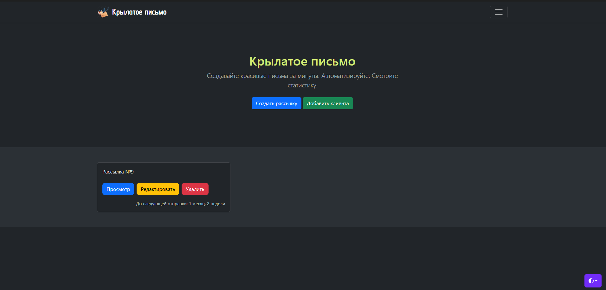
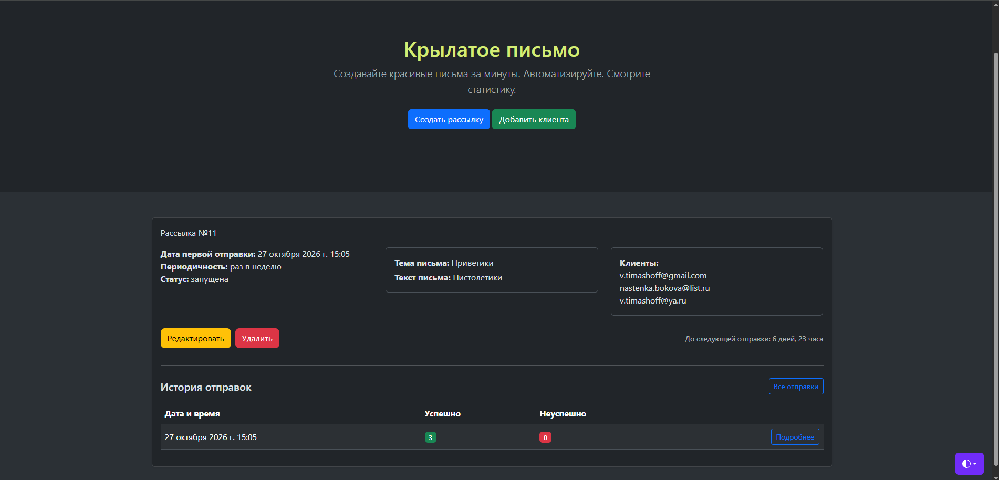
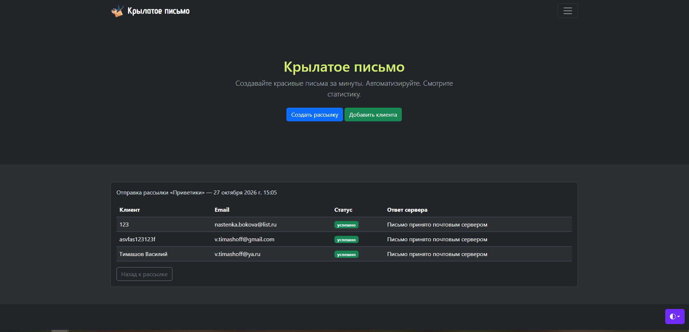
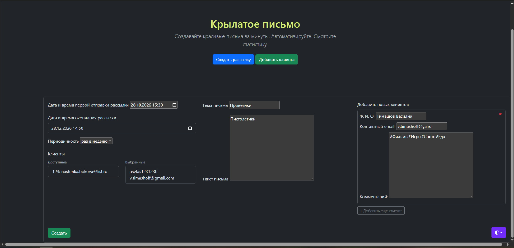
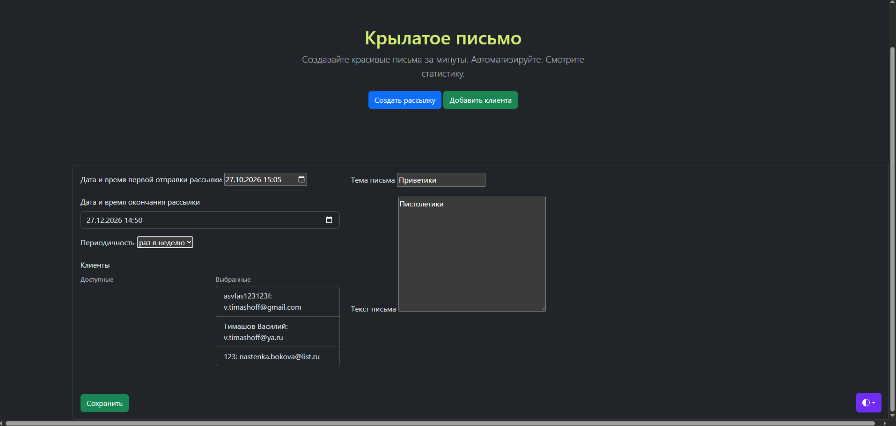
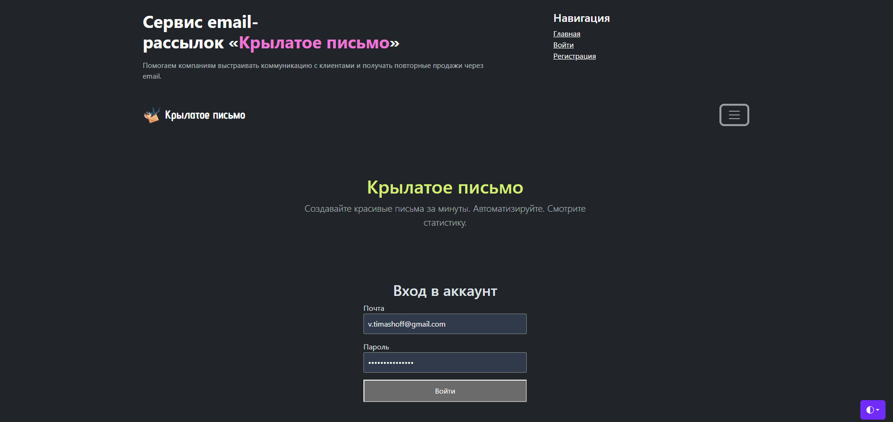

# django-mailing-service

Сервис управления email-рассылками «Крылатое письмо» на Django. Пользователь регистрируется, подтверждает почту, создаёт рассылки для списка клиентов и следит за историей отправок. Рассылки отправляются по расписанию в фоне через Celery.

## Скриншоты

### Список рассылок



### Страница рассылки



### Статистика запуска



<details>
<summary>Ещё скриншоты</summary>

### Создание рассылки



### Редактирование рассылки



### Вход



</details>

## Возможности

- Регистрация по email с подтверждением почты по ссылке (токен живёт 24 часа), вход по email
- CRUD рассылок: тема и текст письма, список клиентов, дата первой и последней отправки, периодичность (раз в день, неделю или месяц)
- Каждый пользователь видит и редактирует только свои рассылки
- Клиентов можно добавлять прямо при создании рассылки (formset) или отдельной формой
- Список клиентов, их просмотр(вне создания рассылки), правка и удаление доступны только группе `managers`
- Отправка по расписанию: Celery beat раз в минуту ищет наступившие рассылки и ставит по задаче на каждую
- История запусков: у каждого запуска сохраняются попытки по каждому клиенту со статусом и ответом почтового сервера
- Кеширование в Redis страниц с историей запусков
- Ручная отправка командой `send_mailings`
- Тесты на модели, формы, сервисы, задачи и представления

## Стек

| Назначение | Технология |
| --- | --- |
| Backend | Python 3.11+, Django 5.2 |
| База данных | PostgreSQL |
| Кеш и брокер | Redis |
| Фоновые задачи | Celery + Celery beat |
| Фронтенд | Django templates, Bootstrap 5 |
| Зависимости | Poetry |

## Быстрый старт

Понадобятся Python 3.11+, [Poetry](https://python-poetry.org/), PostgreSQL и Redis.

```bash
git clone https://github.com/dargel799/django-mailing-service.git
cd django-mailing-service

poetry install
```

Создайте базу данных:

```sql
CREATE DATABASE mailings;
```

Скопируйте пример настроек и заполните его:

```bash
cp env.example .env        # Windows (cmd): copy env.example .env
```

Примените миграции и создайте администратора (email и пароль берутся из `ADMIN_EMAIL` и `ADMIN_PASSWORD` в `.env`):

```bash
poetry run python manage.py migrate
poetry run python manage.py csu
```

Запустите сервер:

```bash
poetry run python manage.py runserver
```

Сайт откроется на http://127.0.0.1:8000/.

### Фоновая отправка

Для автоматической отправки нужны ещё два процесса, каждый в своём терминале:

```bash
# worker
poetry run celery -A config worker -l info

# планировщик
poetry run celery -A config beat -l info
```

Рассылку можно отправить и вручную, без Celery:

```bash
poetry run python manage.py send_mailings
```

### Роль менеджера

Откройте админку (`/admin/`), создайте группу `managers` и добавьте в неё пользователя. После этого ему станет доступен раздел «Список клиентов».

## Настройки окружения

Все переменные описаны в [`env.example`](env.example).

| Переменная | Описание |
| --- | --- |
| `SECRET_KEY` | Секретный ключ Django |
| `DEBUG` | `True` для разработки |
| `SITE_URL` | Адрес сайта, нужен для ссылки подтверждения почты |
| `EMAIL_BACKEND`, `EMAIL_HOST`, `EMAIL_PORT`, `EMAIL_USE_SSL`, `EMAIL_HOST_USER`, `EMAIL_HOST_PASSWORD` | Настройки SMTP (по умолчанию Яндекс, порт 465) |
| `REDIS_CACHE_URL` | Redis для кеша |
| `CELERY_BROKER_URL`, `CELERY_RESULT_BACKEND` | Redis для Celery |
| `POSTGRES_DB`, `POSTGRES_USER`, `POSTGRES_PASSWORD`, `POSTGRES_HOST`, `POSTGRES_PORT` | Подключение к PostgreSQL |
| `ADMIN_EMAIL`, `ADMIN_PASSWORD` | Данные для команды `csu` |


## Тесты

```bash
poetry run python manage.py test
```

Django создаст отдельную тестовую базу, поэтому пользователю PostgreSQL нужны права на создание баз.

## Как это работает

```
Celery beat (каждые 60 с)
    └── dispatch_due_mailings        находит рассылки с наступившим временем
            └── send_mailing_task    по одной задаче на рассылку
                    └── send_mailing
                          1. блокирует рассылку (select_for_update)
                          2. сдвигает next_send_at на следующий период
                          3. создаёт MailingRun
                          4. шлёт письмо каждому клиенту, пишет Attempt
                          5. сбрасывает кеш, закрывает рассылку после последней отправки
```

Статусы рассылки: `создана` → `запущена` → `завершена`.

### Модели

- `User`: пользователь с входом по email и подтверждением почты
- `Client`: получатель письма (уникальный email)
- `Message`: тема и текст письма
- `Mailing`: расписание, периодичность, статус, владелец, клиенты
- `MailingRun`: один запуск рассылки
- `Attempt`: попытка отправки конкретному клиенту (статус и ответ сервера)

### Принятые решения

- **Общая база клиентов.** Пользователи могут добавлять контакты в единый список и использовать его при создании своих рассылок. В будущем можно добавить тарифы с разными лимитами на количество клиентов.
- **Защита от дублей.** Время следующей отправки сдвигается до начала отправки, внутри транзакции с блокировкой строки. Если задача поставлена дважды, вторая ничего не отправит. Обратная сторона: при падении worker посреди отправки остаток писем не будет повторён до следующего периода.
- **Ошибки SMTP не ломают запуск.** Неудачная отправка клиенту фиксируется в `Attempt` со статусом и текстом ошибки, а остальные клиенты обрабатываются дальше.

## Структура проекта

```
config/      настройки Django, конфигурация Celery
mailings/    рассылки, клиенты, запуски, попытки; сервисы и Celery-задачи
users/       пользователь, регистрация, подтверждение почты
static/      Bootstrap и изображения
```

## Основные страницы

| URL | Назначение |
| --- | --- |
| `/` | Мои рассылки |
| `/create/` | Создать рассылку |
| `/<id>/` | Детали рассылки и последние запуски |
| `/<id>/runs/` | Все запуски рассылки |
| `/run/<id>/` | Попытки конкретного запуска |
| `/clients/` | Список клиентов (группа `managers`) |
| `/users/register/`, `/users/login/` | Регистрация и вход |
| `/admin/` | Админка |

## Автор

Vasya, [@dargel799](https://github.com/dargel799)